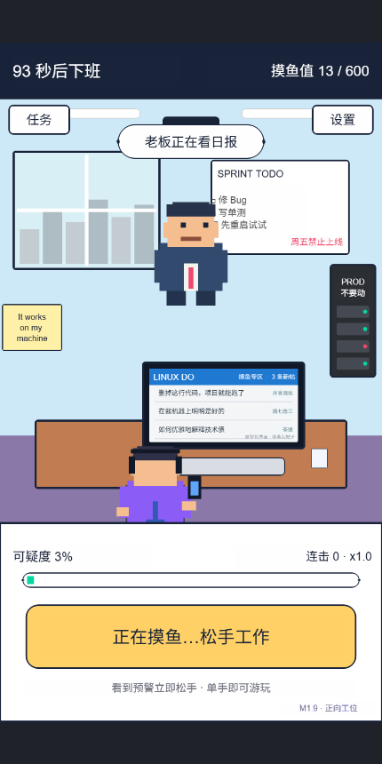

# 今天也想准时下班

> 一款写给实习生和程序员的竖屏摸鱼小游戏。

[下载 Android 安装包](https://github.com/xyl9q/today-i-want-to-leave-on-time/releases/latest) · Cocos Creator 3.8.7 · TypeScript



## 为什么做这个游戏

研三的时候，我在某车企实习。

那段时间的日常，大概是在需求、Bug、日报、会议和“这个功能应该很简单吧”之间来回横跳。白天盯着编辑器假装一切尽在掌握，偶尔打开论坛喘口气；听到身后有脚步声，又会条件反射地切回代码界面。到了下班时间，最大的愿望往往只剩一句：**今天也想准时下班。**

于是我把这段略显荒诞、又很真实的实习体验做成了一个小游戏。它不是什么严肃作品，只是一份研三实习生活的纪念，也算送给所有一边修 Bug、一边等待下班的程序员。

游戏中的公司、人物、需求和事件均为虚构或泛化创作，不对应任何真实企业及个人，也不包含实习单位的内部信息。

## 怎么玩

- 按住鼠标左键或触摸屏幕：开始摸鱼，积累摸鱼值。
- 松开鼠标或手指：立刻切回工作状态。
- 老板进入预警或检查状态时要及时收手。
- 只按住不放会被发现；没有实际摸鱼也不会凭空获得躲避奖励。
- 在时间结束前攒够摸鱼值，就能准时下班。

## 目前包含

- 老板安全、预警、检查三种状态
- 摸鱼值、可疑度、连击与倍率系统
- 准时下班、被迫加班、惨遭开除三种结局
- 18 个程序员主题随机事件和若干行业梗
- 首次进入的三步新手教学
- 任务、设置、重新开始和重看教学
- Linux DO 风格的虚构论坛界面
- 代码绘制的像素办公室、老板和背对玩家的主角
- 鼠标与移动端触摸操作支持

## 技术栈

- Cocos Creator 3.8.7
- TypeScript
- Android WebView 离线封装
- Node.js 内置测试运行器
- 代码原生绘制像素美术，正式包不依赖第三方图片素材

核心规则与 Cocos 场景分离，状态机位于 `assets/scripts/core/`，界面和像素绘制主要位于 `assets/scripts/GameBootstrap.ts`。

## 本地运行

安装 Cocos Creator 3.8.7 后，用编辑器打开项目并预览 `assets/scenes/Main.scene`。

运行规则测试：

```bash
npm test
```

构建 Web Mobile 版本：

```bash
npm run build:web
```

产物位于 `build/web-mobile/`。

Android 用户可以前往 [Releases](https://github.com/xyl9q/today-i-want-to-leave-on-time/releases) 下载 APK。由于安装包未上架应用商店，安装时可能需要允许浏览器或文件管理器“安装未知应用”。

## 后续计划

- 继续调整事件、数值和演出节奏
- 构建微信小游戏版本
- 根据试玩反馈补充更多程序员梗

## 说明

这是一个个人练习性质的小项目，欢迎试玩、提 Issue，或者贡献你在工位上遇到的离谱故事。

论坛界面仅为虚构致敬设计；第三方资源与许可证说明见 [THIRD_PARTY_NOTICES.md](THIRD_PARTY_NOTICES.md)。
